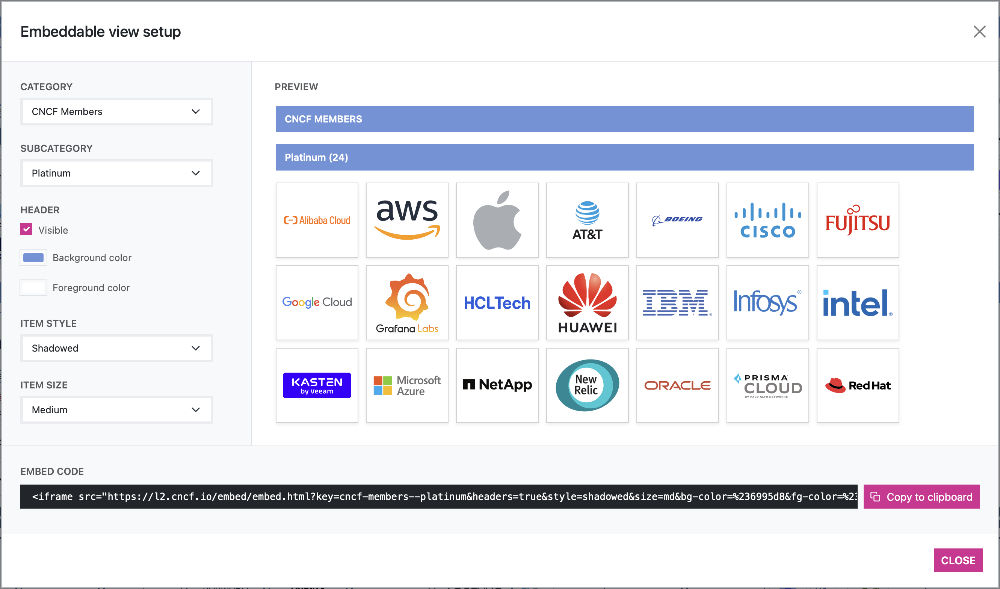

# Landscape2

**Landscape2** is a tool that generates interactive landscapes websites.

You can check out how the generated landscapes look like by visiting the [CNCF landscape](https://landscape.cncf.io). Additional landscapes generated by this tool can be found in the [landscape2-sites repository](https://github.com/cncf/landscape2-sites#landscape2-sites).

<br/>
<table>
    <tr>
        <td width="50%"></td>
        <td width="50%"></td>
    </tr>
    <tr>
        <td width="50%"></td>
        <td width="50%"></td>
    </tr>
    <tr>
        <td width="50%"></td>
        <td width="50%"></td>
    </tr>
</table>

## How it works

**Landscape2** is a CLI tool that generates static websites from the information available in the data sources provided. These data sources are passed to the tool via arguments, usually in the form of *urls* or *local paths*, and are as follows:

- **Landscape data**. The landscape data file is a YAML file that describes the items that will be displayed in the landscape website. For more information, please see the [reference documentation](https://github.com/cncf/landscape2/blob/main/docs/config/data.yml).

- **Landscape settings**. The settings file is a YAML file that allows customizing some aspects of the generated landscape website, such as the logo, colors, how to group items or which ones should be featured. For more information about the settings file, please see the [reference documentation](https://github.com/cncf/landscape2/blob/main/docs/config/settings.yml).

- **Landscape guide**. The guide file is a YAML file that defines the content of the guide that will be displayed on the landscape website. For more information, please see the [reference documentation](https://github.com/cncf/landscape2/blob/main/docs/config/guide.yml).

- **Landscape games**. The games data file is a YAML file that defines the content of the games that will be displayed on the landscape website. For more information, please see the [reference documentation](https://github.com/cncf/landscape2/blob/main/docs/config/games.yml).

- **Logos location**. Each landscape item *must* provide a valid relative reference to a logo image in the landscape data file (item's `logo` field). SVG logos are recommended, but png, jpg, gif, webp, bmp and tiff images are supported as well (the viewBox adjustment and the title cleanup done during the build only apply to SVG logos). The logos data source defines the location of those logos (base *url* or *local path*), so that the tool can get them as needed when processing the landscape items.

### Data collection from external services

In addition to the information available in the landscape data file, the tool collects more data *during the landscape generation* from external sources (such as **GitHub** or **Crunchbase**) if the required credentials are provided. These credentials must be provided via environment variables.

- **GitHub**: a list of comma separated GitHub tokens with `public_repo` scope can be provided in the `GITHUB_TOKENS` environment variable. When these tokens are not provided, no new information is collected from GitHub, and only the data already cached (if any) is used. If the expected number of items in the landscape is large it is recommended to provide more than one token to avoid hitting rate limits and speed up the collection of data (the concurrency of the process will be based on the number of tokens provided). Whitespace around each token and empty entries are ignored.

- **Crunchbase**: a Crunchbase API key can be provided in the `CRUNCHBASE_API_KEY` environment variable. If this key is not provided, no new information is collected from Crunchbase, and only the data already cached (if any) is used. Please note that landscape2 *needs access to the full Crunchbase API*, which requires an [Enterprise or Application license](https://data.crunchbase.com/docs/using-the-api).

## Installation

### Pre-built binaries

Binary downloads of the landscape2 CLI tool can be found in the [releases page](https://github.com/cncf/landscape2/releases).

#### Install via Homebrew

```text
brew install cncf/landscape2/landscape2
```

#### Install via shell script

```text
curl --proto '=https' --tlsv1.2 -LsSf https://github.com/cncf/landscape2/releases/download/v1.1.0/landscape2-installer.sh | sh
```

#### Install via powershell script

```text
irm https://github.com/cncf/landscape2/releases/download/v1.1.0/landscape2-installer.ps1 | iex
```

### Container image

The landscape2 CLI tool is also distributed in a [container image](https://github.com/cncf/landscape2/pkgs/container/landscape2). This image can be used both to run the tool locally or from your [CI workflows to automate the generation of landscapes](https://github.com/cncf/landscape2-sites/tree/main/.github/workflows). The [landscape2-validate-action](https://github.com/cncf/landscape2-validate-action), which can be used to check that the landscape data, settings, guide and games files are valid, also uses this image.

The image is published with the following tags:

- `latest`: tracks the `main` branch.
- `sha-<commit>`: the image built from that commit (the full commit SHA).
- `vX.Y.Z`: the image of that release (for example `v1.1.0`).

`latest` changes with every commit merged to `main`, so we recommend pinning a version tag (`vX.Y.Z`) in your CI workflows.

### Building from source

You can build **landscape2** from the source by using [Cargo](https://rustup.rs), the Rust package manager. [wasm-pack](https://wasm-bindgen.github.io/wasm-pack/installer) is required to build the wasm modules. [Node.js](https://nodejs.org) 26 and [Yarn classic](https://classic.yarnpkg.com/lang/en/docs/install/) (1.22) are also required during the installation process to build the web application, which will be embedded into the `landscape2` binary as part of the build process. The build installs the UI dependencies with `yarn install --frozen-lockfile`, so it fails if a `yarn.lock` file is out of date instead of updating it.

```text
cargo install --git https://github.com/cncf/landscape2
```

```text
landscape2 --help

Landscape2 CLI tool

https://github.com/cncf/landscape2#usage

Usage: landscape2 <COMMAND>

Commands:
  build     Build landscape website
  deploy    Deploy landscape website (experimental)
  new       Create a new landscape from the built-in template
  serve     Serve landscape website
  validate  Validate landscape data sources files
  help      Print this message or the help of the given subcommand(s)

Options:
  -h, --help     Print help
  -V, --version  Print version
```

## Usage

To see **landscape2** in action, we will go through the process of creating, building and serving a new landscape from scratch. The following instructions will assume that the `landscape2` binary is available in your PATH. Alternatively, you can launch a container from the [image provided](https://github.com/cncf/landscape2/pkgs/container/landscape2) where the **landscape2** CLI tool is ready to use.

### Creating a new landscape

The `new` subcommand allows us to create a new landscape from a built-in template. This template includes some sample data source files that you can use as a starting point for your landscapes.

The following command will create the directory `my-landscape` if it doesn't already exist and will copy into it the files in the built-in template:

```text
landscape2 new --output-dir my-landscape
```

```text
INFO new: landscape2::new: creating new landscape from the built-in template..
INFO new: landscape2::new: landscape created! (took: 0.006s)

✅ Landscape created successfully!

You can build it by running the following command:

👉 cd my-landscape && landscape2 build --data-file data.yml --settings-file settings.yml --guide-file guide.yml --games-file games.yml --logos-path logos --output-dir build
```

Existing files are never overwritten: when some of the template files already exist in the output directory, the command fails listing them and writes nothing. Add `--force` to overwrite them:

```text
landscape2 new --output-dir my-landscape --force
```

### Building the landscape website

The build process is in charge of generating the landscape website from the information available in the data sources provided. Now we'll build the landscape we created in the previous step by using the `build` subcommand. Please note that the `new` subcommand already suggested us to do this in its output and even printed the full command to use for us.

> [!NOTE]
> During the build process, landscape2 will try to take a screenshot of your landscape if the required settings were provided in the settings.yml file. This screenshot will be available for download from the generated web application (in PNG and PDF format), and is taken by launching Chrome/Chromium in headless mode. Chrome/Chromium is looked up first in the `CHROME` environment variable (the path to its executable) and then in the `PATH` (for example as `google-chrome-stable`, `chromium` or `chrome`) and, on macOS and Windows, in the standard installation locations. If Chrome/Chromium is not available, the screenshot won't be taken and a warning will be raised.

> [!TIP]
> Besides the website, the build generates a JSON API (`api/`) and some downloadable files (`docs/items.csv`, `docs/projects.csv`, `docs/projects.md` and the screenshot). They are the stable outputs meant to be consumed by other applications, and are documented in [docs/api.md](docs/api.md).

The following command will build the landscape and write the resulting files to the `output-dir` provided (*build* in this case):

> [!IMPORTANT]
> On every build, the subdirectories generated by landscape2 in the output directory (`api`, `data`, `docs`, `embed`, `images`, `logos` and `sources`) and the generated `index.html` and `kiosk.html` files are removed and written again, so files from previous builds are never published. Other files in the output directory (for example `CNAME`) are kept. The data, settings, guide and games files and the logos path cannot be located inside those subdirectories.

```text
cd my-landscape
```

```text
landscape2 build \
  --data-file data.yml \
  --settings-file settings.yml \
  --guide-file guide.yml \
  --games-file games.yml \
  --logos-path logos \
  --output-dir build
```

```text
INFO build: landscape2::build: building landscape website..
WARN build:collect_crunchbase_data: landscape2::build::crunchbase: crunchbase api key not provided: only cached information will be used
WARN build:collect_crunchbase_data: landscape2::build::crunchbase: no crunchbase data available for organization url=https://www.crunchbase.com/organization/cloud-native-computing-foundation err=crunchbase api key not provided
WARN build:collect_github_data: landscape2::build::github: github tokens not provided: only cached information will be used
WARN build:collect_github_data: landscape2::build::github: no github data available for repository url=https://github.com/cncf/landscape2 err=github tokens not provided
INFO build: landscape2::build: landscape website built! (took: 2.939s)

✅ Landscape built successfully!

You can see it in action by running the following command:

👉 landscape2 serve --landscape-dir build
```

> [!IMPORTANT]
> Without the credentials required to collect data from external services (GitHub and Crunchbase) the resulting site won't contain all the information available on the CNCF demo site. In this case, we didn't provide them intentionally, so we were warned about it in the command output (see WARN entries).

### Serving a landscape

The result of the build process is a **static website** that you can deploy on your favorite hosting provider. To make it easier to try your landscapes, **landscape2** includes a `serve` subcommand that will launch an HTTP server and serve the contents of your landscape. In our example, the build output displayed the command to do this, so we'll go ahead and give it a try:

```text
landscape2 serve --landscape-dir build
```

```text
INFO serve: landscape2::serve: http server running (press ctrl+c to stop)

🔗 Landscape available at: http://127.0.0.1:8000/
```

If you visit `http://127.0.0.1:8000` in your browser you should see the landscape you just created in action. Now you can iterate by editing the files in the `my-landscape` directory until your landscape is ready.

One option to serve your landscape in production is to use a static site hosting service like [GitHub Pages](https://pages.github.com). In [this repository](https://github.com/tegioz/sample-landscape) you can find a full example of a landscape generated by the `landscape2 new` command that is automatically built and deployed to GitHub pages (using the `build` branch) on every commit to the `main` branch. Please note that the [sample workflow used to build and deploy](https://github.com/tegioz/sample-landscape/blob/main/.github/workflows/build.yml) requires **write** permissions.

> [!NOTE]
> The resulting website when building a landscape is a [single-page application](https://en.wikipedia.org/wiki/Single-page_application) that handles routing on the client side. This means that you'll need to configure your webserver to serve the `index.html` file for the SPA route paths (like '/guide', '/stats', etc). One way of doing this would be to serve that file when a non existent path is requested. The `serve` subcommand included in **landscape2** already handles this for us. In the GitHub pages example mentioned above, this is achieved by copying the content of the `index.html` file to the `404.html` file, which will be served when a non existent path is requested.

> [!NOTE]
> If you plan to host the generated landscape in a subpath instead of at the
> root of your domain (for example `/landscape`), make sure to set the
> `base_path` field in your `settings.yml` file accordingly. The `serve`
> subcommand reads it from the build output and serves the landscape under
> that path (for example `http://127.0.0.1:8000/landscape/`).

### Deploying to S3 (experimental)

The `deploy s3` subcommand uploads the landscape website to an AWS S3 bucket:

```text
landscape2 deploy s3 --bucket <name> --landscape-dir build
```

- The AWS region and credentials are resolved from the standard AWS SDK sources: environment variables, the shared config and credentials files (profiles, including SSO), or the container or instance role. A region is required: set `AWS_REGION` or a region in the AWS profile.
- Only new or changed files are uploaded. Changes are detected by comparing the MD5 digest of each file with the ETag of the deployed object, so objects encrypted with SSE-KMS or uploaded in multiple parts are uploaded again on every run.
- Each object gets a `Cache-Control` header based on its path, the same one `serve` uses: files whose names change with their content (`assets/`, `embed/assets/` and `logos/`) can be cached for a year, and the rest must not be cached.
- The index document (`index.html`) is uploaded last, once all the other files have been uploaded successfully.
- Objects that are not part of the local build are kept, unless `--delete-stale` is set (opt-in). They are then deleted after the index document has been uploaded. Clients still holding a previous index document may fail to load the hashed assets it references.

### Validating data, settings, guide and games files

The **landscape2** CLI tool includes a subcommand named `validate` that allows you to check that your landscape data, settings, guide and games files are valid. If you are interested in integrating this validation in your CI workflows (i.e. to enforce that those files are valid before merging a PR), please take a look at the [landscape2-validate-action](https://github.com/cncf/landscape2-validate-action).

```text
landscape2 validate settings --settings-file cncf/settings.yml

Error: the landscape settings file provided is not valid

Caused by:
    color1 is not valid (expected format: "rgba(0, 107, 204, 1)" or "rgb(0, 107, 204)")
```

Unknown keys are reported as warnings (`warning: <message>`, on stderr), and the file is still considered valid.

The games file is validated in the same way:

```text
landscape2 validate games --games-file games.yml

The landscape games file provided is valid!
```

When validating a games file, a landscape data file (`--data-file`) or URL (`--data-url`) can also be provided to check that every quiz option matches an item in the landscape data. The `build` subcommand always runs this check when a games file is provided.

```text
landscape2 validate games --games-file games.yml --data-file data.yml
```

### Performance considerations when building

Collecting data from external services (GitHub, Crunchbase and CLOMonitor) can take some time, especially in landscapes with lots of items. **Landscape2** caches the collected data to make subsequent runs faster:

- The cache lives in the `landscape` subdirectory of the cache directory. By default, that is the user's cache directory (for example, `~/.cache/landscape` on Linux). A different cache directory can be set with `--cache-dir`, and the `landscape` subdirectory is used under it as well. It holds the GitHub data (`github.json`), the Crunchbase data (`crunchbase.json`) and the CLOMonitor report summaries (`clomonitor_*.svg`).
- Cached data is fresh for 7 days. Expired data is refreshed on the next build. When the refresh fails, or the `GITHUB_TOKENS` or `CRUNCHBASE_API_KEY` credentials are not provided, the expired data is used as is, so items keep their GitHub and Crunchbase information.
- Several landscapes can share a cache directory. Each build merges the data it collected with the existing cache entries, and removes the entries it doesn't use that were collected more than 90 days ago. Cache files are written atomically (to a temporary file that then replaces the cache file), so an interrupted build never leaves a partially written cache file behind.
- The `github.json` and `crunchbase.json` files carry a format version. A cache written by an older landscape2 release, without a version, is migrated automatically. A cache file with an unknown version (for example, written by a newer release) or with corrupt content is ignored with a warning, and it is only replaced once new data has been fetched.
- Concurrent builds should use separate cache directories. Otherwise, a build may overwrite the data cached by another one running at the same time.
- Logos are processed on every build. They are not cached, but a logo shared by several items is fetched and processed once.

Please keep this in mind when running the tool periodically from your workflows, and make sure the cache directory is saved and restored on each run. You can find some examples of how to achieve this in the [workflows in the landscape2-sites repository](https://github.com/cncf/landscape2-sites/tree/main/.github/workflows).

### Embeddable views

**Landscape2** allows other websites to embed a view to display the items in one or more categories or subcategories. The embed code can be easily obtained from the corresponding landscape website by visiting `/embed-setup` (i.e. in the case of the CNCF landscape, the url would be <https://landscape.cncf.io/embed-setup>). The customization options available can be adjusted as needed, and the generated embed code will be updated accordingly.



#### Resizing embeds with iframe-resizer

Embeddable views can also adjust the height of their iframe to their content using [iframe-resizer](https://github.com/davidjbradshaw/iframe-resizer/tree/v4.3.9) **4.x**. The embed page ships the iframe-resizer 4.x child script (version 4.3.9, MIT license), which is loaded only when the embed url includes `iframe-resizer=true`.

This option is not available in the embed setup view: copy the embed url generated there and append `&iframe-resizer=true` to it. The host page must then load the matching iframe-resizer **4.x** parent script and initialize it on the iframe:

```html
<iframe
  id="landscape-embed"
  src="https://landscape.example.org/embed/embed.html?<options from /embed-setup>&iframe-resizer=true"
  style="width: 1px; min-width: 100%; border: none;"
  scrolling="no"
></iframe>
<script src="https://cdn.jsdelivr.net/npm/iframe-resizer@4.3.9/js/iframeResizer.min.js"></script>
<script>
  iFrameResize({ checkOrigin: ['https://landscape.example.org'] }, '#landscape-embed');
</script>
```

> [!WARNING]
> Do not use iframe-resizer v5 (`@iframe-resizer/parent`) on the host page: it is licensed under GPL-3.0 or a commercial license, and it warns about legacy child scripts like the one shipped by the embed page.

> [!NOTE]
> The vendored child script is used unmodified, so it accepts the init message from any parent origin and posts its size messages with target origin `'*'`. These messages carry only layout data. The `checkOrigin` option protects the host page, not the embed.

### Kiosk page

Every build writes a `kiosk.html` page that shows a single project of the landscape in a layout suited to kiosk screens and mobile devices: its name, logo, foundation and maturity badges, description, primary repository stats (stars, contributors, license and latest release) and links (website, repository, good first issues, and community and social channels). The project is selected with the `item` query parameter:

```text
/kiosk.html?item=<id>
```

The `<id>` is the id used by the generated API: the page loads the project from `api/projects/<id>.json`, relative to its own location. It therefore depends on the API written by the same build (the ids are listed in `api/index.json` and in the `id` column of `docs/projects.csv`), and has to be served together with it.

The page uses the following settings:

- `colors`: the landscape palette (the default palette when the settings have no `colors` section).
- `foundation`: the foundation badge, the page title and the *Powered by* footer.
- `images.favicon`: the page icon.
- `url`: the footer link and the *Browse the landscape* link of the states below.

When no project can be shown, the page displays a *No data available* card, with a message and a *Browse the landscape* link, in these cases:

- The page URL has no `item` query parameter.
- The API has no project with that id (for example, the item is not a project or the id is misspelled).
- The API response does not contain a project.
- The request fails (for example, a network error).

### Overlay

**Landscape2** supports applying one or more data source files to an existing landscape at runtime. Any of those files can -and often will- be different than the ones used originally to build the landscape. This feature aims to be the building blocks of a preview system.

Some examples of it in action (live demos!):

- [Preview some changes in the settings file (like a Christmas edition theme)](https://landscape.cncf.io/?overlay-settings=https://raw.githubusercontent.com/tegioz/landscape2-overlay-tests/main/settings-christmas.yml)
- [Check out how the CNCF landscape would look like using a 5 years old `landscape.yml` file (Helm was still in incubating!)](https://landscape.cncf.io/?overlay-data=https://raw.githubusercontent.com/cncf/landscape/6ff062c72b7229bbe60fee3aca5f8999624459f2/landscape.yml&overlay-logos=https://raw.githubusercontent.com/cncf/landscape/6ff062c72b7229bbe60fee3aca5f8999624459f2/hosted_logos&overlay-settings=https://raw.githubusercontent.com/tegioz/landscape2-overlay-tests/main/settings-5-years-ago.yml)

To achieve this, the overlay redoes part of the landscape build process in the browser, reusing the same codebase packed as a WASM module.

The overlay can be enabled by providing any of the following query parameters to the landscape url (they can be combined if needed):

- `overlay-data`: *data file url*
- `overlay-settings`: *settings file url*
- `overlay-guide`: *guide file url*
- `overlay-games`: *games data file url*
- `overlay-logos`: *logos base url*

The quiz uses the questions of the `overlay-games` file when it is provided, and the ones of the deployed landscape otherwise.

Local paths in the settings header logo, footer logo and favicon point to the images the build deployed for those same paths, so an image that has not been deployed yet must be deployed first or provided as a URL. URLs are loaded directly.

When `overlay-logos` is not provided, each item takes its logo and CLOMonitor summary from the matching item of the deployed landscape: the one with the same id (`category--subcategory--name`) or, for items moved to another category or subcategory, the only deployed item with exactly the same name. Items with no match (new items, or names shared by several deployed items) are displayed without logo and CLOMonitor summary.

The overlay logs its warnings in the browser console: items not found in the deployed landscape, and unknown keys in the overlay files (prefixed with the kind of file, like `settings: unknown key …`).

When `overlay-guide` or `overlay-games` is not provided, the overlay uses the deployed guide or games file, if any. A file that is missing (a 404 response, or an HTML page served instead, like the `index.html` file served for non existent paths) is ignored, but any other error loading it (or an invalid file) makes the overlay fail, as does any error loading a file provided explicitly.

> [!WARNING]
> The overlay feature is still experimental and may not work as expected in all cases. Please report any issues you find!

## Adopters

A list of landscapes built using **landscape2** is available at [ADOPTERS.md](./ADOPTERS.md). Please consider adding yours!

## Contributing

Please see [CONTRIBUTING.md](./CONTRIBUTING.md) for more details.

## Code of Conduct

This project follows the [CNCF Code of Conduct](https://github.com/cncf/foundation/blob/master/code-of-conduct.md).

## License

Landscape2 is an Open Source project licensed under the [Apache License 2.0](https://www.apache.org/licenses/LICENSE-2.0).

It bundles some third-party files, distributed under their own licenses (the Orbitron font under the SIL Open Font License 1.1, and the iframe-resizer child script under the MIT license), which are listed in [THIRD_PARTY_NOTICES.md](./THIRD_PARTY_NOTICES.md).
